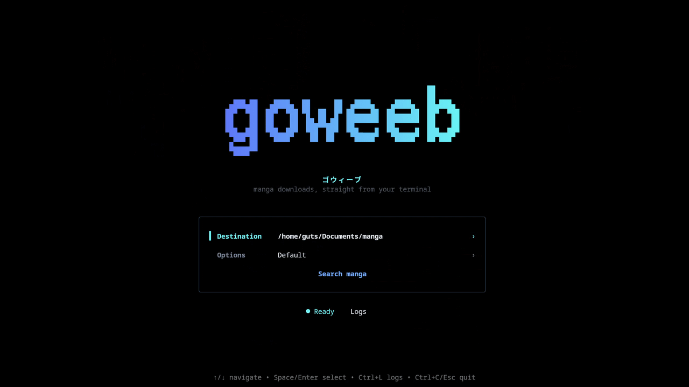
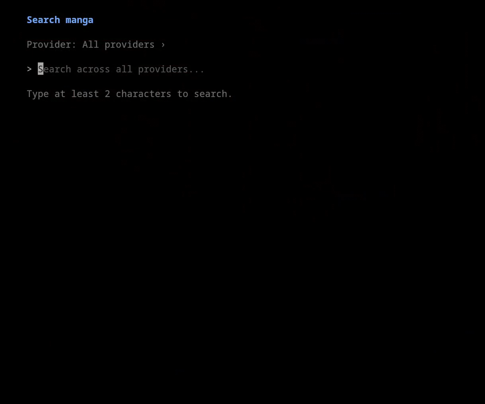

[English](README.md) | **Français**

# goweeb

[](https://github.com/EliasLd/goweeb/releases/latest)
[](https://github.com/EliasLd/goweeb/actions/workflows/ci.yml)
[](https://github.com/EliasLd/goweeb/actions/workflows/container.yml)
[](https://github.com/EliasLd/goweeb)

**Téléchargez des mangas directement depuis votre terminal.**

goweeb est un téléchargeur de mangas multiplateforme disponible à la fois sous la forme d'une **interface terminal interactive (TUI)** et d'une **interface en ligne de commande (CLI)** flexible.



## Fonctionnalités

- TUI interactif et CLI adapté aux scripts.
- Plusieurs fournisseurs de mangas et plusieurs langues.
- Sélection flexible des chapitres avec des formats comme `1-10`, `10-`, `-5` ou `1-10,20,30-40`.
- Recherche interactive multi-fournisseurs : interrogez tous les fournisseurs à la fois, ou filtrez sur un seul.
- Prise en charge des numéros de chapitre entiers et décimaux.
- Gestion automatique des chapitres indisponibles à l'intérieur des plages demandées.
- Sortie en PDF, archives CBZ (avec métadonnées ComicInfo.xml) ou dossiers d'images adaptés aux liseuses.
- `--continue` reprend là où vous en étiez, grâce à un manifeste par œuvre dont les enregistrements sont revérifiés sur disque à chaque exécution.
- Métadonnées par œuvre : auteur, couverture, description, tags et année attachées au ComicInfo.xml et au manifeste quand le fournisseur les publie, avec une recherche de couverture dégradée (fournisseur → AniList).
- Nouvelles tentatives HTTP automatiques en cas de connexion instable ou d'erreurs temporaires côté serveur.
- Domaines personnalisés et miroirs compatibles pour les fournisseurs.
- Binaires natifs pour Linux, macOS et Windows.
- Image de conteneur OCI pour `linux/amd64` et `linux/arm64`.

### Recherche interactive

Recherchez un manga directement depuis le TUI et parcourez les résultats correspondants au fur et à mesure de votre saisie, avec une navigation entièrement au clavier, de la recherche jusqu'à la sélection.

Par défaut, la recherche interroge **tous les fournisseurs à la fois** et affiche leurs résultats dès qu'ils arrivent, en les étiquetant avec le fournisseur dont ils proviennent :

```text
1. Blue Lock [MangaDex (Multilingual)]
2. Blue Lock: Episode Nagi [Atsumoe (English)]
```

Les résultats sont triés avec les correspondances les plus proches de la recherche en premier. `Ctrl+P` (ou un clic) ouvre le filtre de fournisseur dans l'écran de recherche — tous les fournisseurs par défaut, ou un seul en particulier. Choisir un fournisseur depuis les résultats poursuit automatiquement le flux avec celui-ci.



## Démarrage rapide

### Installation native

Téléchargez la dernière version correspondant à votre système d'exploitation :

[**Télécharger la dernière version**](https://github.com/EliasLd/goweeb/releases/latest)

Lancez ensuite le TUI interactif :

```bash
./goweeb
```

Ou utilisez le CLI :

```bash
goweeb --source weebcentral --range 1-10 "blue lock"
```

### Conteneur

L'image officielle contient à la fois le **TUI** et le **CLI** :

```text
ghcr.io/eliasld/goweeb:latest
```

Téléchargez-la avec Podman :

```bash
podman pull ghcr.io/eliasld/goweeb:latest
```

Créez un dossier local pour les téléchargements :

```bash
mkdir -p downloads
```

Lancez le TUI :

```bash
podman run --rm -it \
  --userns=keep-id:uid=1000,gid=1000 \
  -v "$(pwd)/downloads:/home/goweeb/Documents:Z" \
  ghcr.io/eliasld/goweeb:latest
```

Ou utilisez le CLI :

```bash
podman run --rm -it \
  --userns=keep-id:uid=1000,gid=1000 \
  -v "$(pwd)/downloads:/home/goweeb/Documents:Z" \
  ghcr.io/eliasld/goweeb:latest \
  cli --source weebcentral --range 1-10 "blue lock"
```

> [!IMPORTANT]
> Le conteneur officiel enregistre les téléchargements dans `/home/goweeb/Documents`.
> Montez ce dossier en tant que volume afin de conserver les fichiers téléchargés sur la machine hôte.

L'image est compatible OCI et peut également être utilisée avec Docker. Selon votre plateforme et votre runtime de conteneur, les options de gestion des permissions des montages peuvent différer.

## Fournisseurs pris en charge

| Fournisseur | Langue | Site web |
| --- | --- | --- |
| WeebCentral | Anglais | https://weebcentral.com |
| MangaDex | Multilingue | https://mangadex.org |
| MangaDot | Anglais | https://mangadot.net |
| MangaBall | Multilingue | https://mangaball.com |
| Mangavyvy | Anglais | https://mangavyvy.com |
| MangaFreak | Anglais | https://ww3.mangafreak.me |
| Atsumoe | Anglais | https://atsu.moe |
| Anime-Sama | Français | https://anime-sama.pw |

> [!NOTE]
> Les entrées MangaDex hébergées sur des sites externes sont actuellement ignorées. goweeb télécharge uniquement les chapitres directement hébergés par MangaDex.

> [!TIP]
> La prise en charge de nouveaux fournisseurs peut être ajoutée sans modifier le workflow principal de téléchargement.

## Installation

### Windows

1. Téléchargez l'archive Windows depuis la [dernière release](https://github.com/EliasLd/goweeb/releases/latest).
2. Extrayez-la dans le dossier de votre choix.
3. Ouvrez PowerShell ou CMD dans ce dossier.
4. Lancez l'exécutable TUI ou CLI.

### Linux / macOS

Téléchargez l'archive correspondant à votre système d'exploitation (`darwin` pour macOS), puis rendez le binaire exécutable :

```bash
chmod +x goweeb
```

Vous pouvez ensuite, si vous le souhaitez, le déplacer dans un dossier présent dans votre `PATH` :

```bash
sudo mv goweeb /usr/local/bin/
```

### Compiler depuis les sources

Clonez le dépôt :

```bash
git clone https://github.com/EliasLd/goweeb.git
cd goweeb
```

Compilez le TUI :

```bash
go build -o goweeb-tui ./cmd/goweeb-tui
```

Compilez le CLI :

```bash
go build -o goweeb-cli ./cmd/goweeb-cli
```

## Interface terminal

Le TUI est la manière la plus simple d'utiliser goweeb de façon interactive.

Lancez-le puis laissez-vous guider par l'interface :

```bash
./goweeb
```

Le fonctionnement est simple :

1. Saisissez le titre d'un manga.
2. Configurez les options de sortie.
3. Recherchez : tous les fournisseurs sont interrogés à la fois, ou utilisez le filtre de fournisseur dans l'écran de recherche.
4. Sélectionnez le bon manga lorsque plusieurs résultats sont trouvés.
5. Sélectionnez une version du scan ou une langue lorsque cela est nécessaire.
6. Choisissez les chapitres à télécharger.
7. Suivez directement la progression du téléchargement dans le TUI.

Lorsqu'un seul manga ou une seule version de scan est disponible, goweeb le sélectionne automatiquement.

## Interface en ligne de commande

Le CLI est utile pour les scripts, l'automatisation ou pour télécharger rapidement des chapitres connus à l'avance.

### Syntaxe de base

```bash
goweeb --source <provider> [options] "manga-name"
```

L'option `--source` est obligatoire en mode CLI.

Les titres de mangas peuvent être placés entre guillemets ou non. Les guillemets sont recommandés pour les titres contenant des espaces.

Lorsque vous utilisez un titre sans guillemets, placez-le après toutes les options du CLI.

### Options

| Option | Raccourci | Description |
| --- | --- | --- |
| `--source <provider>` | — | Fournisseur utilisé pour rechercher et télécharger le manga. Obligatoire en mode CLI. |
| `--all` | `-a` | Télécharger tous les chapitres disponibles. |
| `--range <selection>` | `-r` | Télécharger des chapitres précis, des plages ou plusieurs plages. |
| `--scan-dir <folder>` | `-d` | Dossier de sortie. Par défaut : `scan` avec le CLI natif. |
| `--ebook-friendly` | — | Enregistrer les images des chapitres dans des dossiers `Chapter XXX/` au lieu de générer des PDF. |
| `--cbz` | — | Enregistrer chaque chapitre sous forme d'archive CBZ (pages numérotées `001.jpg`, `002.jpg`, …) au lieu de générer des PDF. Ne peut pas être combinée avec `--ebook-friendly`. |
| `--layout <scheme>` | — | Schéma de nommage des fichiers téléchargés. `series` (par défaut) regroupe les fichiers par œuvre avec des noms adaptés aux lecteurs ; `flat` conserve le nommage d'origine. Voir [Disposition de la sortie](#disposition-de-la-sortie). |
| `--continue` | `-c` | Ignorer les chapitres déjà téléchargés dans le dossier de sortie. Voir [Reprendre les téléchargements](#reprendre-les-téléchargements). |
| `--no-external-covers` | — | Désactiver la recherche de couverture en base externe (AniList) quand aucun fournisseur n'en propose. Voir [Métadonnées des œuvres](#métadonnées-des-œuvres). |
| `--domain <url>` | `-u` | Remplacer le domaine par défaut du fournisseur sélectionné. |
| `--debug` | — | Activer les logs de debug détaillés. |

Dans le conteneur officiel, le dossier de sortie est fixé à :

```text
/home/goweeb/Documents
```

### Plages de chapitres

Formats pris en charge :

```text
10             # Chapitre 10 uniquement
1-10           # Chapitres 1 à 10
10-            # Du chapitre 10 jusqu'au dernier chapitre disponible
-10            # Les 10 derniers chapitres disponibles
1-10,20-30     # Plusieurs plages
1,5,10         # Chapitres individuels
1-10,25,40-50  # Plages et chapitres individuels combinés
```

Les chapitres décimaux sont également pris en charge :

```text
6.5
1-6.5
6,6.5,7
```

Les sélections sont comparées aux chapitres réellement disponibles chez le fournisseur sélectionné.

Par exemple, si seuls les chapitres `1-50` et `70-100` sont disponibles, demander :

```text
1-100
```

téléchargera les chapitres disponibles tout en ignorant automatiquement les chapitres `51-69`.

Si ni `--all` ni `--range` ne sont fournis, goweeb vous demandera interactivement quels chapitres vous souhaitez télécharger.

## Disposition de la sortie

Par défaut, goweeb regroupe tous les téléchargements d'une œuvre dans un dossier nommé d'après la série, avec des noms de fichiers préfixés et adaptés aux lecteurs qui trient dans l'ordre de lecture. Ce schéma est reconnu par les bibliothèques comme Komga et Kavita :

```text
scan/
└── One Piece/
    ├── One Piece - c001.cbz
    ├── One Piece - c006.5.cbz
    └── One Piece - c010.cbz
```

Les titres de séries contenant des caractères interdits dans les chemins (barres obliques, deux-points, …) sont nettoyés dans les noms de dossiers et de fichiers.

Utilisez `--layout flat` pour conserver le nommage plat historique :

```text
scan/
├── One Piece_1.cbz
├── One Piece_6.5.cbz
└── One Piece_10.cbz
```

Le schéma `series` s'applique à tous les modes de sortie : archives CBZ et PDF, ainsi que les dossiers de chapitres en mode ebook-friendly.

## Reprendre les téléchargements

`--continue` saute les chapitres déjà téléchargés dans le dossier de sortie :

```bash
goweeb --source mangadex --all --continue "one piece"
```

Elle se combine avec les autres options de sélection : `--all --continue` récupère uniquement les chapitres manquants, et `--range 1-100 --continue` récupère uniquement les chapitres manquants dans cette plage.

goweeb conserve un petit manifeste JSON par œuvre dans son dossier de sortie :

```text
scan/
└── One Piece/
    ├── One Piece - c001.cbz
    ├── One Piece - c002.cbz
    └── One Piece.goweeb.json
```

Le manifeste enregistre ce qui a été produit, dans quel format et à partir de quelle source — plus les métadonnées de l'œuvre quand une recherche en a trouvé :

```json
{
  "version": 1,
  "series": "One Piece",
  "provider": "mangadex",
  "scanPath": "en",
  "workUrl": "https://mangadex.org/title/...",
  "kind": "chapter",
  "metadata": {
    "author": "Eiichiro Oda",
    "coverUrl": "https://uploads.mangadex.org/covers/.../cover.jpg",
    "coverSource": "mangadex",
    "description": "...",
    "tags": ["Action", "Adventure", "Comedy"],
    "originalLanguage": "ja",
    "year": 1997
  },
  "coverFile": "One Piece.cover.jpg",
  "chapters": [
    {
      "number": "6.5",
      "label": "Chapter 6.5",
      "url": "https://mangadex.org/chapter/...",
      "format": "cbz",
      "file": "One Piece - c006.5.cbz",
      "downloadedAt": "2026-11-07T12:00:00Z"
    }
  ]
}
```

Avec le schéma `flat`, le manifeste se trouve à la racine du dossier de sortie, nommé d'après la série.

Les fichiers sur disque restent la source de vérité : chaque exécution revérifie les chapitres enregistrés par rapport aux fichiers réels, si bien que les chapitres supprimés ou endommagés à la main — ou tronqués par un téléchargement interrompu — sont simplement retéléchargés. Un chapitre existant dans un format sera tout de même téléchargé dans un autre format s'il est demandé.

Les manifestes sont écrits à chaque téléchargement (et pas seulement avec `--continue`) : les enregistrements de chapitres et les métadonnées de l'œuvre gardent les dossiers auto-décris pour les autres outils, comme la future interface web.

## Métadonnées des œuvres

goweeb décrit les œuvres qu'il télécharge — auteur, couverture, description, tags, année — quand le fournisseur les publie. Ces données enrichissent le `ComicInfo.xml` des CBZ (Writer, Penciller, Genre, Description, Year, LanguageISO) et sont mises en cache dans le manifeste, de sorte que chaque dossier téléchargé reste auto-décrit.

Les couvertures se déposent à côté du manifeste :

```text
scan/
└── One Piece/
    ├── One Piece.cover.jpg
    ├── One Piece - c001.cbz
    └── One Piece.goweeb.json
```

Quand un fournisseur publie peu de données, une couverture passe par une recherche dégradée, dans l'ordre :

1. le fournisseur de l'œuvre elle-même (données du site uniquement),
2. la base de données [AniList](https://anilist.co) — `--no-external-covers` désactive cette couche,
3. une couverture générée, rendue par les consommateurs (la future interface web) plutôt qu'écrite sur disque.

La garde est délibérée : une couverture (et toute métadonnée) ne s'attache qu'après un appariement de titre exact et non ambigu ; un titre correspondant à plusieurs œuvres n'obtient rien — une mauvaise couverture est pire que pas de couverture.

Les recherches ne font jamais échouer un téléchargement : tout incident se dégrade en métadonnées vides, consigné, et une exécution ultérieure peut les compléter. Les résultats sont mis en cache — une œuvre déjà décrite ne refait aucune requête de métadonnées lors des exécutions suivantes.

## Exemples

### Télécharger tous les chapitres

```bash
goweeb --source mangadex --all "one piece"
```

### Télécharger une plage de chapitres

```bash
goweeb --source weebcentral --range 100-120 "jujutsu kaisen"
```

### Télécharger les derniers chapitres

Télécharger les 10 derniers chapitres disponibles :

```bash
goweeb --source animesama --range -10 "one piece"
```

### Combiner plusieurs options

```bash
goweeb \
  --source weebcentral \
  --range 1-50 \
  --scan-dir scans \
  --ebook-friendly \
  "one piece"
```

### Utiliser un domaine personnalisé

```bash
goweeb \
  --source animesama \
  --domain https://example.com \
  --all \
  "one piece"
```

Les domaines personnalisés peuvent être utiles lorsqu'un fournisseur change de domaine tout en restant compatible avec le scraper existant.

## Mode adapté aux liseuses

> [!WARNING]
> Le mode ebook-friendly ne génère pas de fichiers EPUB.

Au lieu de créer un PDF par chapitre, goweeb enregistre les pages du manga dans des dossiers séparés pour chaque chapitre :

```text
scan/
└── One Piece/
    ├── One Piece - c001/
    │   ├── 001.jpg
    │   ├── 002.jpg
    │   └── ...
    ├── One Piece - c002/
    │   ├── 001.jpg
    │   └── ...
    └── ...
```

Exemple :

```bash
goweeb \
  --source weebcentral \
  --all \
  --ebook-friendly \
  "one piece"
```

Cette structure peut ensuite être traitée par des outils comme [Kindle Comic Converter](https://github.com/ciromattia/kcc) afin de préparer les chapitres pour Kindle, Kobo et d'autres liseuses.

## Mode CBZ

Avec `--cbz`, goweeb enregistre chaque chapitre sélectionné sous forme d'archive CBZ, un fichier par chapitre :

```text
scan/
└── One Piece/
    ├── One Piece - c001.cbz
    ├── One Piece - c002.cbz
    └── ...
```

Chaque archive contient un fichier de métadonnées `ComicInfo.xml` (titre de la série, numéro et libellé du chapitre, nombre de pages) ainsi que les pages du chapitre à sa racine, numérotées séquentiellement afin que les lecteurs conservent l'ordre correct :

```text
ComicInfo.xml
001.jpg
002.jpg
003.jpg
...
```

Les bibliothèques de bandes dessinées comme [Komga](https://komga.org), Kavita et Mihon lisent `ComicInfo.xml` pour indexer automatiquement les chapitres téléchargés.

Les fichiers CBZ fonctionnent avec la plupart des lecteurs de bandes dessinées et peuvent être traités par des outils comme [Kindle Comic Converter](https://github.com/ciromattia/kcc), qui accepte directement le format CBZ en entrée.

Exemple :

```bash
goweeb \
  --source weebcentral \
  --all \
  --cbz \
  "one piece"
```

## Contribuer

Les contributions sont les bienvenues.

L'architecture des fournisseurs de goweeb est conçue pour permettre l'ajout de nouveaux sites de mangas de manière relativement indépendante du reste de l'application.

Les contributions peuvent notamment inclure :

- De nouveaux fournisseurs.
- Des corrections pour les fournisseurs existants.
- Des améliorations du TUI ou du CLI.
- Des tests et des améliorations de fiabilité.
- De la documentation.
- Des rapports de bugs et des suggestions de fonctionnalités.

Consultez [**CONTRIBUTING.md**](CONTRIBUTING.md) pour les instructions de développement et la procédure permettant d'ajouter un nouveau fournisseur.

## Soutenir le projet

Si goweeb vous est utile, pensez à laisser une ⭐ sur le dépôt.

Cela aide le projet à gagner en visibilité et c'est toujours très apprécié.

<a href="https://www.star-history.com/?repos=EliasLd%2Fgoweeb&type=date&legend=top-left">
  <picture>
    <source
      media="(prefers-color-scheme: dark)"
      srcset="https://api.star-history.com/chart?repos=EliasLd/goweeb&type=date&theme=dark&legend=top-left"
    />
    <source
      media="(prefers-color-scheme: light)"
      srcset="https://api.star-history.com/chart?repos=EliasLd/goweeb&type=date&legend=top-left"
    />
    
  </picture>
</a>

## ⚠️ Avertissement

goweeb est destiné à un usage personnel et à des fins éducatives.

Lorsque cela est possible, pensez à soutenir les auteurs et éditeurs de mangas en achetant les éditions officielles ou en utilisant des plateformes de distribution légales.
